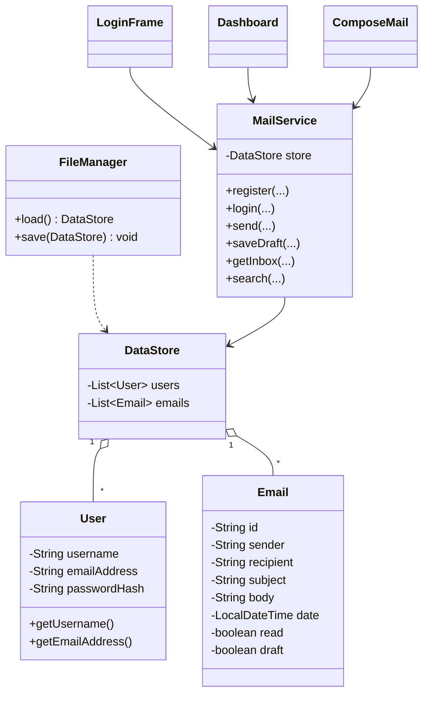

# Project Documentation: Mail Management System Using Java

## 1. Introduction
The Mail Management System is a desktop application developed using Core Java and Java Swing. It allows registered users to exchange messages within the application. Users can compose messages, view received and sent messages, save drafts, search messages, and manage deleted messages. Application data is stored locally using Java file handling.

## 2. Problem Statement
Managing messages in a simple desktop demonstration environment requires a structured way to create user accounts, exchange messages, and organize them. This project provides an easy-to-use internal messaging system without requiring a database or paid external service.

## 3. Objectives
- Apply object-oriented programming concepts in a practical project.
- Create a graphical interface using Java Swing.
- Implement registration and login validation.
- Allow messages to be sent between registered application users.
- Organize messages into Inbox, Sent, Drafts and Trash.
- Use collections and file handling to retain data after restart.
- Practice exception handling and modular class design.

## 4. Features
1. Registration with unique username and email validation.
2. Login using username or registered email address.
3. Inbox showing messages received by the logged-in user.
4. Opening an inbox message marks it as read.
5. Compose and send messages to registered users.
6. Sent folder showing messages sent by the current user.
7. Save, edit and send drafts; delete drafts.
8. Move messages to Trash and restore them.
9. Search the selected folder by subject or sender/recipient address.
10. Save users and messages in a local serialized data file.

## 5. Software and Hardware Requirements
### Software
- Operating system: Windows, macOS or Linux
- Java Development Kit: JDK 17 or later
- IDE: Visual Studio Code or IntelliJ IDEA
- Libraries: Java standard library (Swing, AWT, I/O, Collections, Security and Time)

### Hardware
- Processor: Any modern dual-core processor
- RAM: 4 GB minimum recommended
- Storage: 100 MB free space for source code, compiled classes and data
- Display: Desktop display capable of showing a Swing window

## 6. System Architecture
The project follows a simple layered structure:
- **Presentation layer:** `LoginFrame`, `Dashboard` and `ComposeMail` display screens and collect user input.
- **Service layer:** `MailService` validates users and performs message operations.
- **Model layer:** `User`, `Email` and `DataStore` represent application data.
- **Persistence layer:** `FileManager` loads and saves `DataStore` to `data/mail-data.ser`.

### Class responsibilities
| Class | Responsibility |
|---|---|
| Main | Starts the Swing application |
| User | Stores username, email and password hash |
| Email | Stores sender, recipient, subject, body, date and status flags |
| DataStore | Holds lists of users and emails |
| FileManager | Serializes and deserializes application data |
| MailService | Registration, login, sending, drafts, search and folder operations |
| LoginFrame | Login and registration user interface |
| Dashboard | Folder navigation, message list and message actions |
| ComposeMail | Compose and edit message dialog |

## 7. Class Diagram

## 8. Working Procedure
1. Run `Main.java` to launch the application.
2. A new user creates an account with a username, email address and password.
3. The application validates the input and stores the account.
4. The user logs in with username/email and password.
5. The dashboard displays the user's mail folders.
6. The user composes a message and enters the registered recipient's email, subject and body.
7. `MailService` validates the recipient and stores the message. It appears in the sender's Sent folder and recipient's Inbox.
8. The user can read messages, save drafts, search, delete or restore messages.
9. `FileManager` saves changes to a local file, allowing data to remain after restart.

## 9. Java Concepts Demonstrated
- **Classes and objects:** User, Email, service and GUI objects.
- **Encapsulation:** Model fields are private and accessed through methods.
- **Abstraction / separation of concerns:** GUI screens call MailService rather than directly managing file I/O.
- **Collections:** Lists store registered users and messages.
- **Exception handling:** Invalid input and file errors are handled with exceptions and user messages.
- **File handling:** Object streams persist data locally.
- **Event handling:** Swing buttons and text fields respond to user actions.
- **Date/time API:** LocalDateTime records message timestamps.

Inheritance and polymorphism are also illustrated by Swing classes extending JFrame/JDialog and by the custom list-cell renderer overriding a Swing method.

## 10. Future Scope
- Real external email delivery using SMTP and receiving using IMAP/POP3.
- File attachments and contact management.
- Database storage using JDBC and MySQL/SQLite.
- Password reset, stronger password hashing and improved security.
- Notifications, labels, message sorting and pagination.
- Better UI themes and accessibility improvements.

## 11. Conclusion
The Mail Management System demonstrates how Core Java concepts can be combined to create a useful desktop application. It provides account management and internal message exchange with a Swing interface and local persistence. The project is modular, suitable for academic demonstration, and can be extended with database and network features in future versions.
